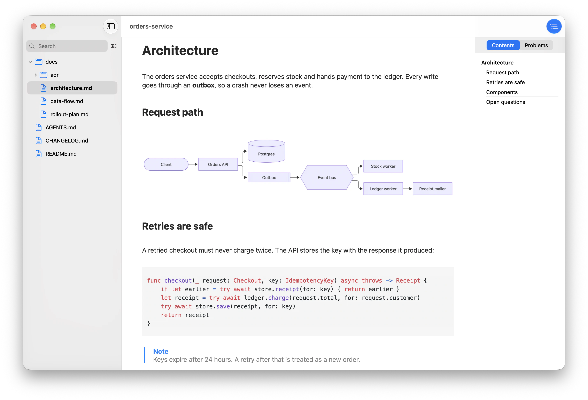
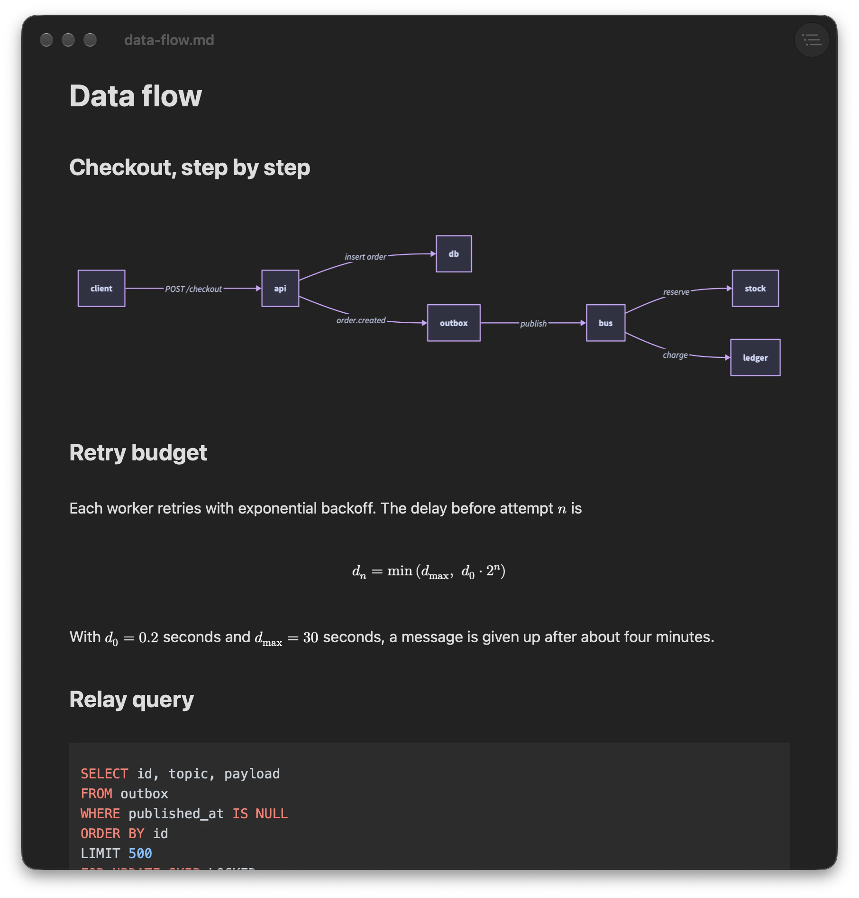
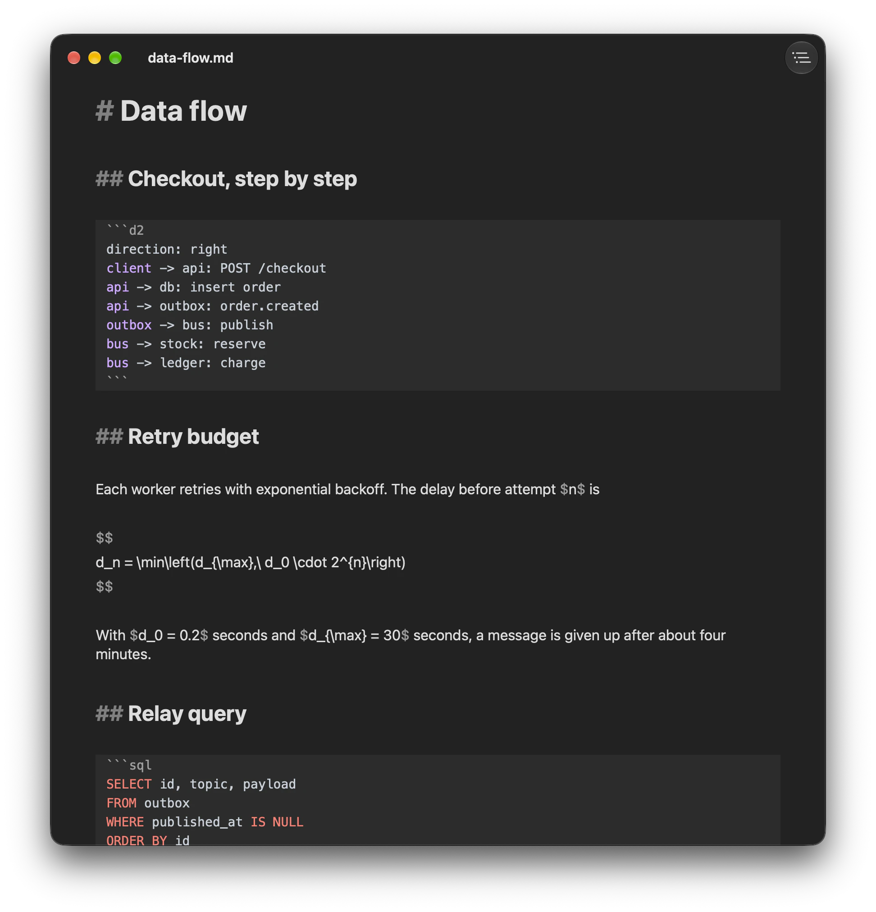
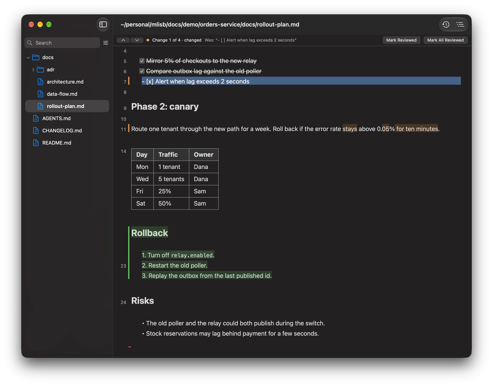
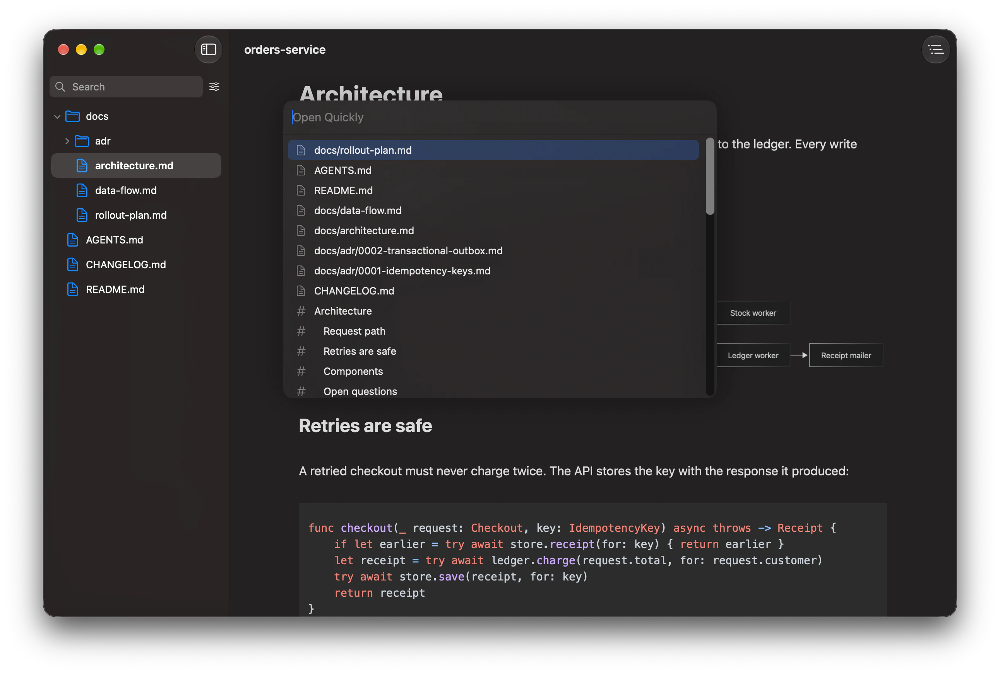

<div align="center">


# mlisb

**Markdown Like It Should Be.**

A native macOS viewer and quick editor for the Markdown files that fill every repository.<br>
Mermaid and D2 diagrams, math and highlighted code render in place.

<a href="LICENSE"></a>
<a href="https://github.com/favoretti/mlisb/releases"></a>


<p>
<a href="#install">Install</a> ·
<a href="#diagrams-math-and-code-in-place">Diagrams</a> ·
<a href="#see-what-your-agent-changed">Change review</a> ·
<a href="#jump-anywhere">Navigation</a> ·
<a href="#from-the-terminal">Terminal</a> ·
<a href="#settings">Settings</a> ·
<a href="CHANGELOG.md">Changelog</a> ·
<a href="docs/DEVELOPMENT.md">Build from source</a>
</p>

<picture>
  <source media="(prefers-color-scheme: dark)" srcset="docs/screenshots/hero-dark.webp">
  
</picture>

</div>

Coding agents write a lot of Markdown: plans, architecture notes, changelogs, READMEs. mlisb is for
reading that output and fixing it on the spot.

A file opens rendered, the way GitHub would show it. Click into a line to edit it, and the syntax
appears only where the cursor is. The file on disk stays plain Markdown. Bytes you did not touch are
saved back exactly as they were, so `git diff` shows only your edits.

It is a Mac app all the way down: native text editing, no Electron, no web view around your
document. It runs in the App Sandbox and needs macOS 14 or later.

## Install

```sh
brew install --cask favoretti/tap/mlisb
```

Or download the latest `mlisb-x.y.z.zip` from the
[releases page](https://github.com/favoretti/mlisb/releases), unzip it and move `mlisb.app` to
Applications. The app keeps itself up to date after that. What changed in each version is in the
[changelog](CHANGELOG.md).

## Diagrams, math and code, in place

A `mermaid` or `d2` code block draws as a diagram right in the text. `$…$` and `$$…$$` render as
math, and code blocks are highlighted. There is nothing to install and nothing leaves your Mac: no
`d2` binary, no Node, no online renderer.

Put the cursor in a diagram to edit its source; move out and it redraws. If the source has a
mistake, the renderer's error shows in place of the diagram. ⌘/ switches the whole document between
rendered and source.

| Rendered | Source (⌘/) |
| --- | --- |
|  |  |

## See what your agent changed

When a file changes on disk while it is open, mlisb reloads it without asking and marks what is
different since you last looked: added lines in green, rewritten lines in amber with the changed
words highlighted, and a marker where lines were removed. Step through the changes with ⌥⌘↓ and
⌥⌘↑, then press **Mark Reviewed** (⌥⌘R).



- **Nothing is overwritten.** If you were typing when the file changed, a banner lets you keep your
  version or load the new one.
- **Local history.** mlisb keeps earlier versions of each file for 30 days. Compare with any of
  them, or restore one (⌃⌘H).
- **Follows the agent.** `mlisb hook install` connects it to Claude Code: every Markdown file the
  agent writes opens in mlisb, without taking focus from your terminal.

## Jump anywhere

**Open Quickly** (⇧⌘O) finds a file in the folder, a heading in the document or any menu command.
**Find in Folder** (⇧⌘F) searches every Markdown file in the sidebar.



The inspector shows the table of contents (⇧⌘T) and a **Problems** list (⇧⌘M): broken links,
anchors that point nowhere, malformed tables and code fences that never close.

## From the terminal

```sh
mlisb .                  # open the current folder
mlisb docs/plan.md:42    # open a file at line 42
mlisb notes.md           # creates the file if it does not exist
pbpaste | mlisb -        # read piped text
mlisb hook install       # open every Markdown file Claude Code writes
```

The Homebrew cask installs the `mlisb` command. Otherwise choose **mlisb → Install Command Line
Tool…** and run the one line it shows; Settings → Setup shows whether the command is installed.
`mlisb hook install` adds one hook to
`~/.claude/settings.json` and keeps a backup of the old file; `mlisb hook uninstall` removes it.

## Also in the box

- **New documents.** File → New Document (⌘N) asks where to save, then opens the empty file ready to
  type. Every document is a real file from the start.
- **Folder sidebar.** New file or folder, rename, drag to move, Move to Trash, Reveal in Finder, and
  a Quick Look preview for images and PDFs.
- **GitHub Flavored Markdown.** Tables, task lists, alerts, footnotes, front matter, reference
  links, strikethrough, autolinks and a safe subset of HTML.
- **Paragraphs wrap to the window**, as on GitHub, even when the file was wrapped by hand. The file
  keeps its own line breaks, and Source Mode shows them.
- **Wide tables and code blocks** spread into the free space beside the text before they wrap or scroll.
- **The full path** of the open file is in the title bar.
- **Saves by itself**, one second after you stop typing, in place.
- **Tabs your way.** A newly opened file becomes a tab or its own window, and the tabs sit across the
  top or in a list down the left side.
- **Comes back as you left it.** The windows you had open reopen at launch, including after an
  update.
- **Export** to HTML, PDF, JPEG and ePub. **Copy as** plain text, rich text, Markdown or HTML.
- **Quick Look.** Press Space on a Markdown file in Finder for a rendered preview.
- **Careful with links.** A link to another Markdown file opens in the app. Anything that would
  leave the app asks first.
- **Help → mlisb Help** opens a built-in guide, itself a Markdown document with live diagrams.
- **File types:** `md`, `markdown`, `mdown`, `mkd`, `mdx`, `qmd`, `rmd`, `mdc`.

## Settings

**mlisb → Settings** (⌘,) has four groups:

| Group | Setting | What it does |
| --- | --- | --- |
| General | Reopen windows from last time | Brings back the windows that were open. On by default. |
| General | Open files in | A file opened while a window is showing becomes a new tab (the default) or a new window. |
| General | Show tabs | Across the top (the default) or as a list down the left side. |
| Reading | Text size | 12 to 24 points. |
| Reading | Line width | Narrow, Medium (the default), Wide, or Full width to use the whole window. |
| Setup | Default app for Markdown files | Make Default opens every Markdown file with mlisb. |
| Setup | Command line tool | Shows where `mlisb` is installed, or how to install it. |
| Setup | Claude Code | Copies the `mlisb hook install` command. |
| Updates | Automatic checks and installs | Check for updates by itself, and optionally install them; Check Now looks immediately. |

## Keyboard shortcuts

| Shortcut | Action |
| --- | --- |
| ⌘N | New document |
| ⌘O | Open a file or folder |
| ⇧⌘O | Open Quickly |
| ⇧⌘F | Find in Folder |
| ⌘F | Find in the document |
| ⌘/ | Source mode |
| ⇧⌘T | Table of contents |
| ⇧⌘M | Problems |
| ⌥⌘↓ / ⌥⌘↑ | Next / previous change |
| ⌥⌘R | Mark Reviewed |
| ⌃⌘H | Version history |
| ⌘B / ⌘I / ⇧⌘X | Bold / italic / strikethrough |
| ⌘E / ⌘K | Inline code / link |
| ⌘1 / ⌘2 / ⌘3 | Heading level 1 / 2 / 3 |
| ⌘+ / ⌘- / ⌘0 | Bigger / smaller / actual size |
| ⌘, | Settings |

## Where it differs from GitHub

GitHub is the reference for how a document should look. These are the known differences:

- An opening code fence with no closing fence stays ordinary text, so typing a fence does not turn
  the rest of the document into code.
- `<br>` outside a table shows as a dimmed tag, and `<details>` is always expanded.
- A reference-style image (`![alt][label]`) shows as a link. Remote images are not loaded.
- Footnote definitions do not span continuation lines, and a code block inside a list item is drawn
  flush left.
- Indented (four-space) code blocks, and HTML outside the safe subset, show as plain text.
- A diagram is fitted to the window width when it is drawn. It does not refit while the window is
  being resized.

## Development

Building, testing and releasing are described in [docs/DEVELOPMENT.md](docs/DEVELOPMENT.md). What
changed in each version is in [CHANGELOG.md](CHANGELOG.md). The plan and current status are in
[PLAN.md](PLAN.md).

## Licenses

mlisb is released under the MIT license, see [LICENSE](LICENSE). The parts it builds on keep their own.
The full texts are in [THIRD-PARTY-NOTICES.md](THIRD-PARTY-NOTICES.md), and the app shows them in its
About window.

- MarkdownEngine (vendored, modified): Apache-2.0, see `Vendor/MarkdownEngine/LICENSE`.
- mermaid, SwiftMath, Sparkle: MIT.
- D2: MPL-2.0. ELK (bundled by mermaid): EPL-2.0.
- highlight.js: BSD-3-Clause, bundled by the engine's code-block product.
