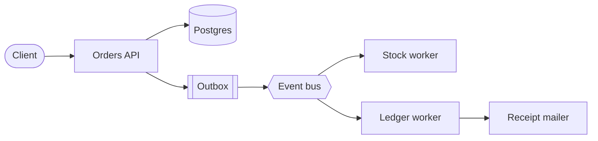

# Architecture

The orders service accepts checkouts, reserves stock and hands payment to the ledger. Every write
goes through an **outbox**, so a crash never loses an event.

## Request path



## Retries are safe

A retried checkout must never charge twice. The API stores the key with the response it produced:

```swift
func checkout(_ request: Checkout, key: IdempotencyKey) async throws -> Receipt {
    if let earlier = try await store.receipt(for: key) { return earlier }
    let receipt = try await ledger.charge(request.total, for: request.customer)
    try await store.save(receipt, for: key)
    return receipt
}
```

> [!NOTE]
> Keys expire after 24 hours. A retry after that is treated as a new order.

## Components

| Component | Owns | Talks to |
| --- | --- | --- |
| Orders API | `orders`, `idempotency_keys` | Postgres, outbox |
| Outbox relay | `outbox` | Event bus |
| Stock worker | `reservations` | Event bus |
| Ledger worker | nothing; calls the ledger | Event bus, ledger |
| Receipt mailer | nothing | Ledger worker |

See [ADR 0001](adr/0001-idempotency-keys.md) and [ADR 0002](adr/0002-transactional-outbox.md) for
why it is built this way, and [Data flow](data-flow.md) for one checkout step by step.

## Open questions

- Should the relay batch by topic, or keep strict id order across topics?
- Who pages when the outbox lag alert fires at night?
